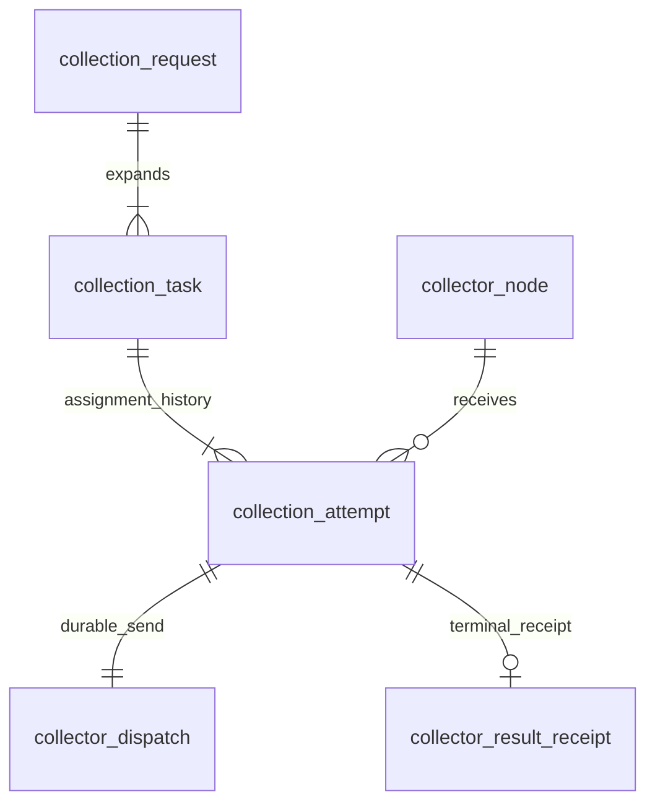

# RGM collection orchestration (#211)

RGM owns scheduling, task expansion, assignment and durable dispatch. Collector executes an explicit
immutable job. This step adds the product side; it does not enable a production collector before
acceptance, credentials, execution and callback ingestion (#212–#217) are implemented.

## Activation and migration

Migration 014 is additive in the **existing RGM database**. It creates six new tables and never copies,
renames, truncates or alters existing collection/history tables. New relationships are logical, without FK.
Existing default execution stays enabled until `rgm.orchestration.enabled=true`. When that flag is true,
DailyPlanner uses the new creation service and both legacy worker pools are excluded. Old planner entry
points and the old Collect POST reject calls with the new route, preventing duplicate legacy work.
Before the final switch, drain/reconcile existing legacy jobs; disabling a pool does not migrate unfinished jobs.
The frontend caller changes in the later UI/API work packages. Do not enable this flag in production yet.

Example operator configuration (node endpoints and pools are trusted deployment configuration):

```yaml
rgm:
  orchestration:
    enabled: true
    default-pool: default
    destination-ref: rgm-results
    job-timeout: 30m
    dispatch-lease: 30s
    retry-delay: 5s
    connect-timeout: 3s
    read-timeout: 10s
    dispatch-interval: 1000 # milliseconds; one dispatch per tick
    allow-http: false
    nodes:
      - key: collector-a
        pool: default
        endpoint: https://collector-a.example
        enabled: true
        service-token: ${COLLECTOR_A_SERVICE_TOKEN}
      - key: collector-b
        pool: large-projects
        endpoint: https://collector-b.example
        enabled: true
        service-token: ${COLLECTOR_B_SERVICE_TOKEN}
    routes:
      - owner: KHolodilin
        pool: default
      - repository-github-id: '123456789'
        pool: large-projects
```

Repository-specific routing wins over owner routing (case insensitive), then default pool. Within a pool,
sorted enabled node keys and a stable GitHub ID hash spread new assignments. Existing attempts retain
their node and endpoint. No configured node for the selected pool causes 503 and rolls back creation.
`collector_node` records assigned nodes; YAML remains the trust authority. Each send rechecks the exact
configured node/endpoint/enabled flag, so a DB-edited URL cannot redirect jobs. Configuration changes
that invalidate an existing assignment block that dispatch for operator recovery rather than sending it elsewhere.
HTTP is permitted only through the explicit development override. Credentials in URL/query/fragment are rejected;
HTTP redirects are never followed. Service tokens remain in deployment configuration, never job payloads or DB.
These authenticate RGM to Collector and are distinct from GitHub tokens. Collector enforces service identity
and durable request idempotency in #212. Disabling RGM planning still permits dispatcher ticks;
`spring.task.scheduling.enabled=false` disables automatic ticks for tests/maintenance.

## API and duplicate policy

`POST /api/v1/admin/repositories/{id}/collections` has no body. Since #212 it requires an `Idempotency-Key` header; see [starter integration](collector-idempotency.md) for actor-scoped replay, conflicts and retention. Existing session Admin authorization and
CSRF protection apply. It snapshots current repository/settings and returns **after transaction commit**:

```json
{
  "requestId": "a3886735-5de8-4c95-b1f2-12f7db4a6f1d",
  "taskIds": ["71611cf3-ffea-4605-8f49-96de35af6819"],
  "coalesced": false
}
```

Response status is 201, including coalesced requests. One active request per repository coalesces manual
double clicks and overlapping scheduled triggers. After completion a new manual action creates a new
request. This is business uniqueness, not a custom HTTP replay engine. Scheduled requests additionally
have a permanent key of repository + business date + snapshot slot (or daily), so repeated ticks after
completion do not repeat that slot. An overlapping slot coalesces with current work instead of creating
a backlog; the next scheduled slot may request a fresh snapshot. Repeated schedule ticks are safe if a
batch stops midway: per-repository transactions and keys let it resume.

Each request expands five repository jobs (stats, traffic, referrers, paths, growth observations), every
enabled search query separately and every enabled topic/language watch separately. TopicWatchSync
derives watches from already stored topics/language using DB operations only; creation calls no GitHub API.
Disabled queries are excluded. Task parameters and configuration snapshots are frozen; the latter include
repository identity and effective growth-event settings for later RGM application. A stable positive SHA-256
fingerprint identifies each task configuration revision. Later edits do not change queued envelopes.

## Tables, indexes and transactions



- `collection_request`: BIGSERIAL private ID, UUID public request ID, repository/date/trigger/state/times.
  Unique trigger key; partial unique repository ID WHERE ACTIVE; repository/created_at descending history index.
- `collection_task`: BIGSERIAL + UUID, request/repository/type/target, JSONB frozen parameters/configuration,
  configuration revision and UUID current_attempt_id. Unique request/type/target and request history index.
- `collection_attempt`: BIGSERIAL + UUID, task/attempt number/node, state/collectorJobId and timestamps.
  Unique task/attempt number; partial unique task WHERE ASSIGNED/ACCEPTED/RUNNING; node/state/time index.
- `collector_node`: BIGSERIAL, unique configured node key, pool/endpoint/enabled/timestamp, enabled pool index.
- `collector_dispatch`: BIGSERIAL, unique attempt UUID, immutable envelope/endpoint/deadline, send counter,
  fenced lease owner/generation, due time and bounded error category. Partial due and expired-lease indexes.
- `collector_result_receipt`: BIGSERIAL, unique event/result/attempt UUIDs, task/node/hash/outcome/received time.
  Task history index. This is the ingestion reservation for #216, not a second acceptance idempotency store.

Creation serializes the repository with a transaction advisory lock, checks business uniqueness, resolves a configured node and commits
request + tasks + initial attempts + dispatch outbox together. UUID IDs are returned only after commit.
Network dispatch claims a row with short FOR UPDATE SKIP LOCKED, commits, and then sends outside all
database transactions. Reclaimed expired leases increment generation; stale owners cannot acknowledge/retry.

POST to the saved node `/internal/v1/jobs` includes a stable `Idempotency-Key: <attemptId>` and the saved
JobRequest. Only a valid 201 with matching job/attempt identity is accepted. ACK stores collectorJobId and
updates pending states only: a terminal callback arriving first cannot be downgraded. Changed local
Collector job identity for an accepted attempt is rejected. Lost responses/crashed senders retry the same
attempt/payload/endpoint, relying on Collector's starter-backed acceptance rather than inventing another replay engine.

Transport failures, 408, 429 and 5xx retry with bounded exponential delay (max five minutes). Other HTTP
rejections, invalid acceptance and untrusted/disabled configuration become BLOCKED for operator recovery.
No response bodies, exception text or credentials are persisted as errors. Lease exceeds HTTP timeouts.
Past-deadline pending work expires without a network call; current pending tasks/attempts fail and the
request closes when no pending tasks remain. ACKED execution reconciliation and cross-node failover are described in [collector-recovery.md](collector-recovery.md).
Callback authentication, application and receipt completion are implemented in [collector-execution.md](collector-execution.md).

## Targeted verification

PostgreSQL 18 Testcontainers and WireMock verify expansion, frozen config, manual/scheduled duplicate policy,
concurrent acceptance/claims, rollback, crash-before-ACK repeat, stale fencing, callback-before-ACK ordering,
retry/block/expiry, non-redirected credentials, scheduler ownership, Admin/CSRF and preservation of a legacy
history sentinel. Existing planner, runtime-role and MVC tests remain regression checks. Full suites,
95% coverage completion, Codecov and the complete local release/migration rehearsal remain the final gate.
