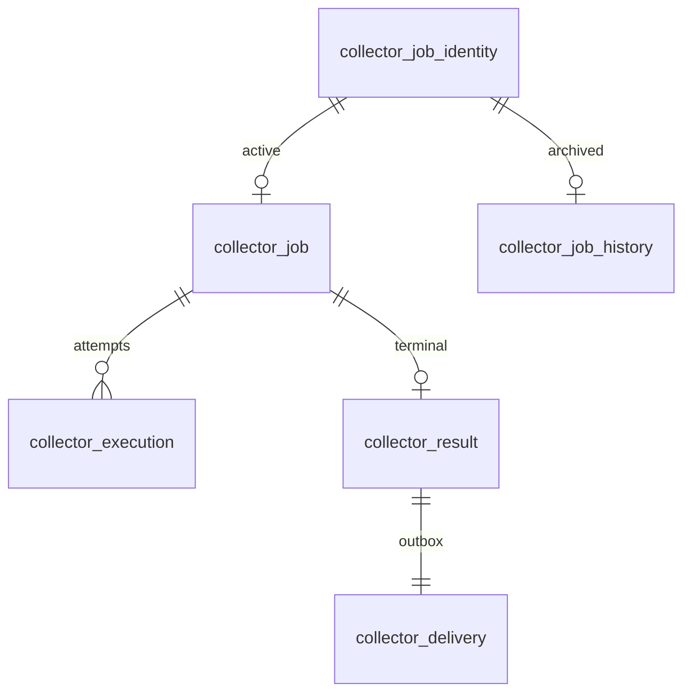

# Collector PostgreSQL storage (#210)

Collector owns a **separate database**, initially on the same PostgreSQL server if desired.
No migration accesses RGM tables or copies existing collection/history. There is no new execution loop yet;
the HTTP acceptance/idempotency adapter (#212), execution (#215) and delivery HTTP (#216) follow later.

Enable `collector.storage.enabled=true` and configure `collector.datasource.url`, `username`, `password`
and `maximum-pool-size` (default 5). In the collector profile their environment equivalents are
`COLLECTOR_STORAGE_ENABLED`, `COLLECTOR_DATASOURCE_URL`, `COLLECTOR_DATASOURCE_USERNAME`,
`COLLECTOR_DATASOURCE_PASSWORD`, `COLLECTOR_DATASOURCE_POOL_SIZE`.
There is no fallback to the product datasource. Use a distinct database/user and grant no access to RGM.
The operator creates that database/role before startup. Liquibase bootstraps only the configured Collector DB.
Back up and restore each database independently; do not restore one node's queue into a second live node.
Infrastructure beans use explicit qualifiers and `defaultCandidate=false` to preserve product auto-configuration.
The migration role currently also owns queue tables/partitions; split runtime/maintenance grants before deploying
untrusted operators. Configuration must point to different database identities, even with different URL aliases.

## Tables and logical relationships (no physical foreign keys)

`collector_job_identity`: BIGSERIAL internal ID, UUID public ID, origin and external job/attempt UUIDs,
SHA-256 immutable acceptance hash, current state, accepted/archived timestamps.
Unique `(origin_id,external_attempt_id)` survives archival and idempotency TTL cleanup indefinitely.
Changed job identity/content for the same attempt is rejected. JSONB key order is normalized before hashing;
the HTTP adapter will validate/version contracts and apply the idempotency starter in #212.

`collector_job`: only active/retry/running work and terminal work awaiting confirmed delivery.
Partial indexes `(next_attempt_at,id) WHERE state IN ('READY','RETRY')` and
`(locked_until,id) WHERE state='RUNNING'`. Claims use a short `FOR UPDATE SKIP LOCKED` transaction.
Each claim increments execution number and fencing generation, including reclaim after lease expiry.
Completion, retry and renewal check owner/generation/unexpired lease. Expired execution is marked explicitly.
Deadline is returned to executor, which must produce a terminal timeout result without making GitHub calls
after expiry (#215). No GitHub/network call belongs inside a storage transaction.

`collector_execution`: BIGSERIAL ID; unique `(job_id,execution_no)`; timestamps/state/worker/generation.
`collector_result`: one immutable terminal payload per job, UUID result/event IDs, SHA-256 payload hash.
Completion writes result and its delivery outbox in the same transaction as terminal state.
`collector_delivery`: unique result ID; destination reference (not arbitrary callback URL), due time,
owner/generation/lease, delivery timestamp. Separate partial due/expired indexes mirror execution claiming.
Acknowledgment and retry are fenced. A crashed sender may redeliver the same event ID (#216 receiver dedup).
`idempotency_records` is the starter's canonical JDBC schema, not a substitute for business identity.

## History and retention

After terminal state **and delivery acknowledgment**, `archive(id,expectedGeneration)` locks active job and
delivery, inserts one complete JSON snapshot (job, executions, result, delivery), records archived timestamp
in the identity registry and removes hot rows in one transaction. An error rolls everything back.
Unfinished retries/callbacks remain hot across month boundaries. Claim SQL references only `collector_job`.

`collector_job_history` uses RANGE `(archived_at)` with UTC monthly bounds and primary key
`(archived_at,job_id)`. Names: `history_2027_02` ([Feb 1, Mar 1)), `history_2027_03` ([Mar 1, Apr 1)).
These examples are created initially; startup and archive maintenance ensure actual current/next months.
No DEFAULT partition, no automatic destructive purge. DDL maintenance occurs outside claims.
`HistoryPartitions.detach(month,retentionCutoff)` is an explicit operator action for closed months outside
the chosen retention window; it detaches, never drops. No default retention duration is imposed.
Detached tables may be exported/backed up and explicitly reattached with PostgreSQL after validation.

Status/result lookup first uses public UUID identity, then the recorded archive timestamp for pruning.
When a partition is detached, identity/state still exist and snapshot is absent: the API adapter must report
archived data unavailable, never accept this as new work. Compact identities are retained permanently.
Workers do not scan archive partitions. PostgreSQL chooses partial index/bitmap/seq plans based on hot-queue
size; isolation from history is structural, not dependent on planner cost estimates.
